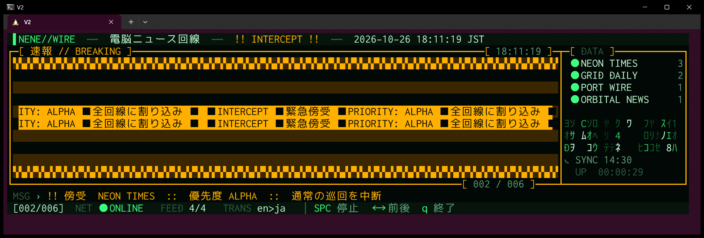
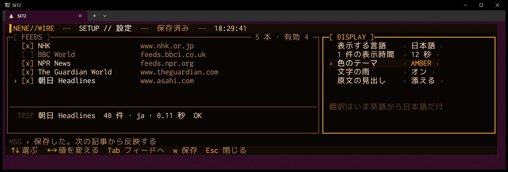
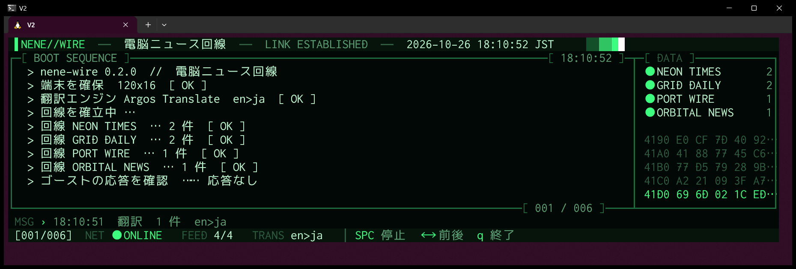
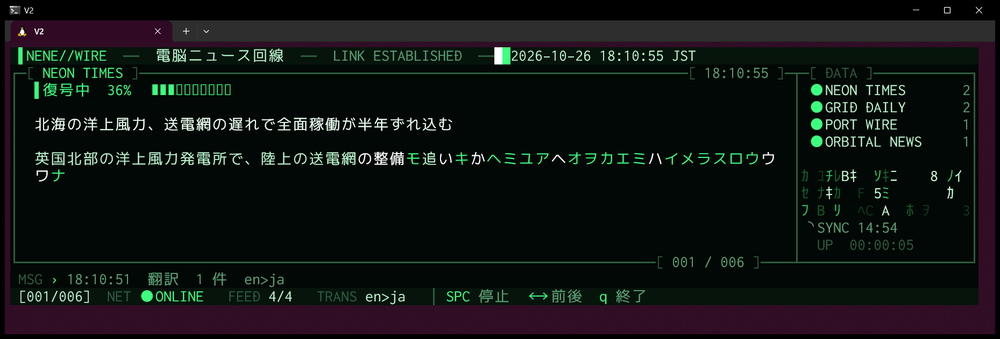
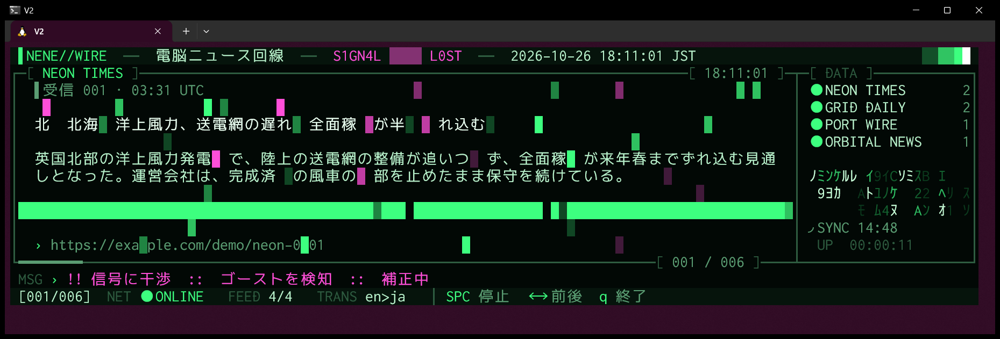
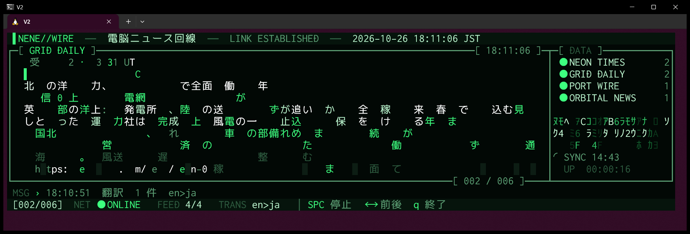
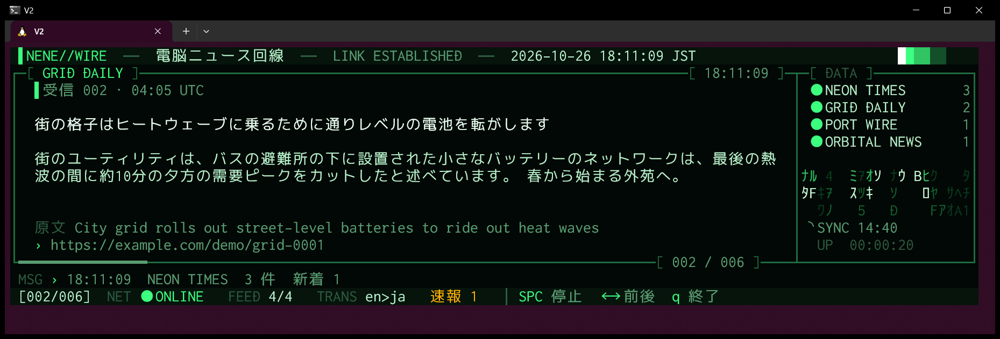

# NeNe Wire

> *端末の最上部に住みつく、電脳ニュース回線。見出しは途切れない。回線を切るなら `q`。*

端末に常駐するニュースティッカー。起動すると画面を消し、最上部の 15 行を幅いっぱいに使う。
登録したフィードの見出しと出だしを 12 秒ごとに 1 件ずつ流し、裏で 15 分おきにフィードを取り直し、新しく現れた記事は **速報** の印を付けて割り込ませる。
[NeNe Gambit](https://github.com/hideyukiMORI/nene-gambit)（チェス）と [NeNe Reversi](https://github.com/hideyukiMORI/nene-reversi) の兄弟。

[](https://github.com/hideyukiMORI/nene-wire/releases/latest)


[English](README.md) · **日本語**



<sub>実機の画面写真: v0.2.0 の配布物を WSL2 の Windows Terminal で動かしたもの（`--demo`・120×16）。
NEON TIMES に新しい記事が届き、割り込む前に緊急傍受の警告が鳴っている。警告の縞と、流れる帯 `INTERCEPT ■ 緊急傍受 ■ PRIORITY: ALPHA`。
この写真のフィードと記事はすべて `--demo` の架空のもの。実際の記事はこのリポジトリに入れない。</sub>

> **ベータ版。** v0.3.0 で設定画面・翻訳のオン／オフ・PowerShell からのインストールが入った。`main` には記事の保存も入っている（前回の記事ですぐ流れ始める）。

---

## インストール

```bash
curl -fsSL https://raw.githubusercontent.com/hideyukiMORI/nene-wire/main/install.sh | bash
```

最新の [Release](https://github.com/hideyukiMORI/nene-wire/releases/latest) を落とし、`SHA256SUMS` で照合してから `~/.local/bin/nene-wire` に入れる。照合に落ちたら何も入れない。
スクリプトは [install.sh](install.sh) の 45 行ほど。パイプに流す前に読んでも 1 分かからない。

- 動作環境: x86_64 の Linux で glibc 2.35 以上（Ubuntu 22.04 以降）と、フィードの取得に使う `curl`。WSL2 の Ubuntu＋Windows Terminal で確かめている
- Swift は要らない。標準ライブラリを静的にリンクした 1 ファイルで、動的な依存は libc・libm・libstdc++・libgcc_s だけ
- アンインストール: `rm ~/.local/bin/nene-wire`

**PowerShell から**（Windows・WSL が入っていること）:

```powershell
irm https://raw.githubusercontent.com/hideyukiMORI/nene-wire/main/install.ps1 | iex
```

既定の WSL のディストリビューションの中で同じインストーラを流し、`%LOCALAPPDATA%\nene-wire\bin` に小さな `nene-wire.cmd` を置いて、そのフォルダをユーザーの PATH に足す。
これで PowerShell からも cmd からも `nene-wire` で起動できる（中身は `wsl.exe` で WSL の nene-wire を呼ぶだけ）。別のディストリビューションに入れるなら `NENE_WIRE_DISTRO` を設定する。
スクリプトは [install.ps1](install.ps1)。アンインストール: `%LOCALAPPDATA%\nene-wire` を消して PATH から外し、`wsl rm ~/.local/bin/nene-wire`

<details>
<summary>手で入れる</summary>

```bash
v=0.3.0
curl -fsSL -O https://github.com/hideyukiMORI/nene-wire/releases/download/v$v/nene-wire-$v-linux-x86_64.tar.gz \
           -O https://github.com/hideyukiMORI/nene-wire/releases/download/v$v/SHA256SUMS
sha256sum --check SHA256SUMS
tar -xzf nene-wire-$v-linux-x86_64.tar.gz
./nene-wire-$v-linux-x86_64/nene-wire
```
</details>

## 眺め方

```bash
nene-wire          # 本物のフィード
nene-wire --demo   # ネットを使わず、架空のフィードと記事で（20 秒後に速報が 1 件届く）
```

| キー | |
| --- | --- |
| `q` | 終了（Ctrl+C でもよい。どう終わっても端末は起動前のとおりに戻る） |
| 空白 | 一時停止 / 再開 |
| `→` / `←` | 次の記事 / 前の記事 |
| `t` | 翻訳のオン／オフ（保存する。いまの記事もすぐ切り替わる） |
| `s` | 設定画面（下に） |

| 起動オプション | |
| --- | --- |
| `--demo` | ネットを使わず、架空のフィードと記事で動かす |
| `--list` | フィードを取って、見出しと出だしを素のまま一覧で出して終わる |
| `--version` | 版を出して終わる |

最初は **NHK・BBC World・NPR News・The Guardian World** の 4 本。設定画面で足せる。
端末は 72×15 以上。帯は窓の幅いっぱいに伸び縮みし、高さはいつも 15 行。

### 設定画面

`s` を押すと、帯が同じ 15 行のまま設定画面に替わる。



- **FEEDS**: `↑↓` 選ぶ・`空白` 有効／無効・`a` 足す（名前と URL を打つ。日本語も打てる）・`e` 直す・`d` 消す（確かめてから）・`t` その場で試す（何件・何語・何秒）
- **DISPLAY**（`Tab` で替える）: `←→` で表示する言語・翻訳する／しない・1 件の表示時間・テーマ（`PHOSPHOR` `AMBER` `CYAN` `MAGENTA`）・文字の雨・原文の見出しを変える
- `w` 保存・`Esc` 閉じる。保存していない変更があると聞いてくる（`w` 保存して閉じる・`x` 捨てる・`Esc` 戻る）。設定画面の中では `q` もただの文字
- `~/.config/nene-wire/settings.txt`（`$XDG_CONFIG_HOME` があればその下）に、版を書いた素の文字列で保存する。読めなければ既定で起動して理由を出し、ファイルは書き換えない

### 翻訳（英語→日本語）

翻訳の手段を入れると、英語の記事を日本語で出し、原文の見出しを添える。
手段は [Argos Translate](https://github.com/argosopentech/argos-translate)。オフラインで動き、アカウントも API キーも要らない。

```bash
curl -fsSL https://raw.githubusercontent.com/hideyukiMORI/nene-wire/main/install-translator.sh | bash
```

- Python 3 と pip が要る（Ubuntu なら `sudo apt install python3-pip`）。置き場は 470 MB ほど（Python のパッケージは `~/.local/share/nene-wire/argos`、モデルは `~/.local/share/argos-translate`）
- Argos はふつう PyTorch（数百 MB〜数 GB）を連れてくる。この導入スクリプトはそれを入れず、文の区切りを Argos 自身の設定の MiniSBD にする
- 入れていなくても止まらない。原文のまま流し、英語の記事に `未翻訳`、状態の行に `TRANS 未導入` と出る
- 訳は覚えておき、起動し直しても訳し直さない。100 件ほどを裏で 20 秒ほどで訳す

### 演出

どの記事にも全部入る。どれも文字と色だけで描いている。

| 接続シーケンス | 復号 |
| --- | --- |
|  |  |
| **電脳ノイズ** | **切り替え** |
|  |  |

- **復号**: `復号中 NN%` と進み具合の棒。文字はカタカナと 16 進の記号でくるくる回ってから止まる。止まり方は 1 文字ずつ・左から・ばらばら（暗号が解けていく感じ）の 3 種
- **切り替え**: 前の記事の文字が重力でパラパラ落ちる、または走査線が消していく
- **電脳ノイズ**: 1 件に 2 回、信号が乱れる。見出しがシアンとマゼンタにずれ、行が横に滑り、`S1GN4L ▒▒▒▒ L0ST`
- **緊急傍受**: 速報は先に警告を鳴らす。警告の縞と流れる帯 `INTERCEPT ■ 緊急傍受 ■ PRIORITY: ALPHA`
- **接続シーケンス**: 最初の記事までは、実際の取得の結果をブートログとして打ち出し、DATA に 16 進のダンプが流れる
- **HUD の呼吸**: 見出しの行を光が往復し、枠が明滅し、DATA に文字の雨と次の同期までの時間と稼働時間。枠の下辺は次の記事までの導火線として燃えていく

### 画面の読み方



- **見出しの行**: 名前・回線の状態（`LINK ESTABLISHED` / `LINK PENDING` / `LINK LOST`）・現地の日時
- **記事の枠**: 上辺にフィード名と時刻。中は、`受信` と記事の番号・公開時刻（UTC）、見出し（2 行まで）、出だし、`原文`（訳したときの原文の見出し）、リンク。速報として割り込んだ記事には `速報` の印
- **DATA**: フィードごとに 1 行。`●` 取れた（更新なしは暗く）・`~` いま取りに行っている・`!` 失敗（`ERR`）・`·` まだ取っていない、と記事の件数
- **MSG**: 取得でいま起きたこと。取得中・件数と新着・更新なし・失敗の理由と何分後に取り直すか
- **状態の行**: 一周の中の位置・`NET ● ONLINE` / `OFFLINE`・記事を出せるフィードの数・`TRANS en>ja ● 待ち N`（訳している・N 件待ち）・待っている速報・キー

全角は 2 桁として数える。日本語も英語も、枠を崩さずに桁数で折り返す。

### 取り方

- 1 度に 1 本ずつ、`curl` で取る。取れたら **15 分**あけ、失敗したら 2・4・8… 分（最大 60 分）あけて取り直す
- 条件付きで取る: 前回の `ETag` / `Last-Modified` を返すので、更新の無いフィードは `304` だけで済む
- フィードごとに最後に取れた分だけを持つので、一晩流してもメモリが増え続けない（95 分の連続運転で 12.5 MB ほどで頭打ち）
- 記事と訳は `~/.local/state/nene-wire/archive.txt` に保存する（30 秒に 1 回まで・終わるとき）。次に起動するとそれですぐ流れ始め、フィードには変わった分だけを聞き、同じ記事を二度訳さない。7 日より古い記事は捨てる
- 一周したら最新の内容で並べ直す（フィードを順に巡りながら新しい順）。新しい記事は一周を待たず、次の 1 件に割り込む（最大 20 件まで待たせる）

---

## 中身の話（6 話）

NeNe Wire はニュースティッカーの顔をしているが、兄弟と同じく **規約を機械に守らせる実験** でもある。
最初のコミットから v0.2.0 の公開まで、すべて 2026-10-26 の 1 日のうちに起きた。以下の数字はどれもリポジトリの記録（ADR・テスト・ゲートの証明）にある。

### 1. 見た目は、デザインの叩き台の上で 3 回やり直した

最初の案は、画面の中央に記事の枠を置き、まわりに文字の雨を降らせるものだった。施主は「方向性はいい。メインの画面は画面の四分の１くらいで、枠はリキッドで」。
次の案で枠を縦横とも画面の半分にすると、「今のウィンドウの高さの半分じゃなくて、幅は100%たかさは15行　とかそう言うかんじ」「とりあえず15行　きめうちにして」。
最初の実装は、プロンプトの下に帯を確保して、上に取得のログを残した。すると「リアルタイムでずっと常駐して…ニュースの下の方によくあるよね。取得ログとかは残さないで、HUDのメッセージの行に出すとかで、固定レイアウトで」。
最後に「アプリ起動したら全画面クリアして最上部に描画のイメージなんだ」。
どれも [REQUIREMENTS](docs/REQUIREMENTS.md) の決定（Q9・Q11）と ADR（[0006](docs/adr/0006-full-width-strip-display.md)・[0007](docs/adr/0007-always-on-ticker.md)）になっている。

### 2. スレッドを 1 本も使わずに、ネットを待つ

どの target でも並行性は禁止（`async`・`Task`・スレッド・Dispatch）。自作の規約検査が字句で落とす。
だから取得は `curl` を子プロセスとして起動して、すぐに返る。プログラムに 1 本だけあるループが、キー入力**と**子プロセスの出力の口を同じ `poll(2)` で待ち、届いた分を読んで描く。
取得の最中もキーは効き、取得の途中で終わると `curl` も止まる。

### 3. 文字の幅は Unicode そのものから

Swift の標準ライブラリは、結合文字か文字かは分かっても、1 桁か 2 桁かは分からない。Foundation も禁止。
そこで一次資料から表を作る。スクリプトが Unicode 16.0 の `EastAsianWidth.txt` を読み、**SHA-256 が合わなければ何も書かずに止まり**、全角の範囲 122 個を生成する。
幅が曖昧な文字は Windows Terminal と同じく 1 桁に数える。2 桁に数えると罫線がずれて枠が崩れる。
折り返しは行頭に `、` `。` や閉じ括弧を置かない（前の 1 文字を連れて次の行へ送る・[ADR 0006](docs/adr/0006-full-width-strip-display.md)）。

### 4. 95 分流したら、テストが見つけなかった不具合が出た

一晩流しても増えないかを確かめるため、配布物を擬似端末の中で 95 分動かし、5 分ごとにメモリを測った。
メモリは 9.8 MB で始まり 12.5 MB で頭打ち。15 分おきの取り直しは予定どおりに来て、NHK は `304 Not Modified` を返した。
ところが MSG の行の記録には、4 本のうち 2 本の結果しか出ていなかった。1 本取り終えた同じ瞬間に次の 1 本を取りに行き、「取得中」の表示が結果を描く前に上書きしていた。
これは Issue #9 になって直った。連続運転では数えられなかった速報の表示は、そのあと `--demo` の画面写真で確かめた。

### 5. 規約は書くのではなく、守らせる

このリポジトリには ID の付いた規則が 72 あり、それぞれに機械が守らせているかどうかの状態がある。いま **51 が active**（破ると `make check` が落ちる）。
残りは「まだ機械では見ていない（planned）」「機械では塞げない」と正直に書いてある（[品質ゲート](docs/QUALITY_GATES.md)）。
規則は兄弟から持ってきたが、実測は持ち越さなかった。製品コードを書く前に Swift 6.4.1 の振る舞いを 75 ケースで測り直し、
落ちるのを見るまでどの検査も信じない。違反を 1 つずつ仕込んで、狙った規則で落ちたことを **63 件**記録してある（ほかに、通らなければならない対照が 2 件・[ゲートの証明](docs/quality/gate-proofs.md)）。
公開もその 1 つで、梱包のスクリプトから静的リンクを外すと、Swift のランタイムに依存する実行ファイルは梱包を拒まれる。

### 6. ニュースの写っていない画面写真

これは個人で眺めるための道具で、実際の見出しや出だしをこのリポジトリに入れたり、再配布したりしない。
だから本物の画面写真は撮れない。`--demo` は、取得 → 予定 → 巡りの同じ経路を架空のフィード 4 本で動かし、20 秒後に架空の速報を 1 件届ける。
このページの写真は、すべて公開した v0.2.0 の配布物をそうやって動かして撮った（[ADR 0008](docs/adr/0008-release-pipeline-and-demo.md)）。

---

## 開発

```bash
make bootstrap           # clone 直後に 1 回（コミットフックと静的な SwiftLint）
make check               # 唯一の完了定義。ローカルと CI で同じ（ビルド・テスト・整形・lint・規約検査・コミットの形）
make release TAG=v<版>   # 配布物を作る（検査に通ったときだけ）
```

- Swift 6.4.1（`.swift-version`）・SwiftPM だけ・製品の外部 Swift 依存はゼロ
- 入口: [CLAUDE.md](CLAUDE.md)（日本語）と [AGENTS.md](AGENTS.md)（英語）。いま機械が何を守らせているかは [docs/QUALITY_GATES.md](docs/QUALITY_GATES.md)、施主の要件は [docs/REQUIREMENTS.md](docs/REQUIREMENTS.md)

## ライセンス

MIT（[LICENSE](LICENSE)）
