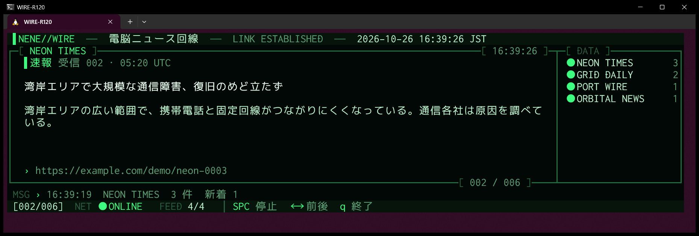
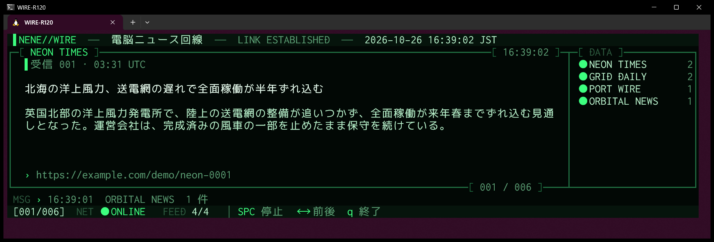
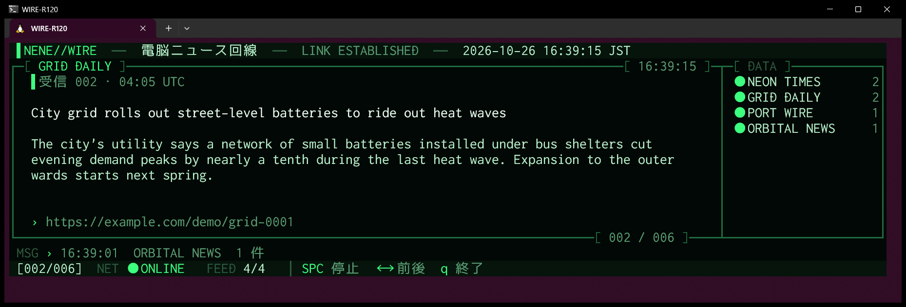

# NeNe Wire

> *A cyber news ticker that lives at the top of your terminal. Headlines keep coming. Press `q` to cut the line.*

A resident news ticker for the terminal. It clears the screen and takes the top 15 rows, full width.
Headlines and ledes from your feeds come through one at a time, every 12 seconds. Each feed is refetched every 15 minutes in the background, and newly arrived stories cut in marked **速報** (breaking).
It is the sibling of [NeNe Gambit](https://github.com/hideyukiMORI/nene-gambit) (chess) and [NeNe Reversi](https://github.com/hideyukiMORI/nene-reversi).

[](https://github.com/hideyukiMORI/nene-wire/releases/latest)


**English** · [日本語](README.ja.md)



<sub>A real screenshot: the v0.1.0 binary running in Windows Terminal on WSL2 (`--demo`, 120×16).
Twenty seconds in, a new story arrives on NEON TIMES and cuts the line with a 速報 mark. The MSG line reports `新着 1` (one new).
Every feed and story in these screenshots is made up by `--demo`; real articles are never stored in this repository.</sub>

> **Beta.** v0.1.0 is the first release. Effects (decoding headlines, typewriter, scan lines, data rain), translation, saved articles and a settings screen are still to come.

---

## Install

```bash
curl -fsSL https://raw.githubusercontent.com/hideyukiMORI/nene-wire/main/install.sh | bash
```

This downloads the latest [release](https://github.com/hideyukiMORI/nene-wire/releases/latest), verifies it against `SHA256SUMS`,
and only then installs it as `~/.local/bin/nene-wire`. If the checksum doesn't match, nothing is installed.
The whole script is [install.sh](install.sh), about 45 lines. Reading it before you pipe it takes under a minute.

- Requirements: Linux on x86_64 with glibc 2.35 or newer (Ubuntu 22.04+), and `curl` (used to fetch the feeds). Tested on Ubuntu under WSL2 with Windows Terminal
- No Swift needed. It is a single file with the Swift standard library linked statically; the only dynamic dependencies are libc, libm, libstdc++ and libgcc_s
- To uninstall: `rm ~/.local/bin/nene-wire`

<details>
<summary>Install by hand</summary>

```bash
v=0.1.0
curl -fsSL -O https://github.com/hideyukiMORI/nene-wire/releases/download/v$v/nene-wire-$v-linux-x86_64.tar.gz \
           -O https://github.com/hideyukiMORI/nene-wire/releases/download/v$v/SHA256SUMS
sha256sum --check SHA256SUMS
tar -xzf nene-wire-$v-linux-x86_64.tar.gz
./nene-wire-$v-linux-x86_64/nene-wire
```
</details>

## How to watch

```bash
nene-wire          # live feeds
nene-wire --demo   # offline, with made-up feeds and stories (a breaking one arrives after 20 seconds)
```

| Key | |
| --- | --- |
| `q` | Quit (Ctrl+C works too; however it ends, your terminal comes back exactly as it was) |
| Space | Pause / resume |
| `→` / `←` | Next / previous story |

| Option | |
| --- | --- |
| `--demo` | Run without the network, on made-up feeds and stories |
| `--list` | Fetch the feeds, print headlines and ledes as plain text, and exit |
| `--version` | Print the version and exit |

The feeds are fixed for now: **NHK, BBC World, NPR News and The Guardian World** (a settings screen comes later).
The terminal needs at least 72×15. The strip stretches to the full width of the window; its height is always 15 rows.

### Reading the screen



- **Header**: the name, the state of the line (`LINK ESTABLISHED` / `LINK PENDING` / `LINK LOST`) and the local date and time
- **Story frame**: the feed's name and the time on top. Inside: `受信` (received) with the story's number and publication time (UTC), the headline (up to two lines), the lede, and the link. A story that cut in as breaking news is marked `速報`
- **DATA**: one row per feed. `●` fetched (dim when nothing changed), `~` fetching right now, `!` failed (`ERR`), `·` not fetched yet, and how many stories it has
- **MSG**: what the fetcher just did: fetching, how many stories and how many new, unchanged, or why it failed and how many minutes until it tries again
- **Status**: position in the cycle, `NET ● ONLINE` / `OFFLINE`, how many feeds are live, and the keys

Wide characters take two columns. Japanese and English wrap by cell width without breaking the frame:



### How it fetches

- One feed at a time, through `curl`. Each feed waits **15 minutes** after a successful fetch, and after a failure it backs off 2, 4, 8… minutes, up to 60
- Conditional requests: it sends back the `ETag` / `Last-Modified` it got last time, so an unchanged feed costs a `304` and nothing more
- It keeps only the latest fetch of each feed, so memory doesn't grow overnight (a 95-minute run stayed at about 12.5 MB)
- When a cycle ends, it is rebuilt from the latest stories, taking turns between feeds and going newest first. New stories don't wait for the cycle: they cut in next, up to 20 queued

---

## Under the hood (a story in six parts)

NeNe Wire wears the face of a news ticker, but like its siblings it is also **an experiment in having machines enforce the rules**.
Everything from the first commit to the v0.1.0 release happened in a single day, 2026-10-26. Every number below is in the repository's records (ADRs, tests, gate proofs).

### 1. The design was argued over in a mock-up, three times

The first design was a box in the middle of the screen with data rain all around it. The project owner said the direction was right but the box should be about a quarter of the screen with a fluid frame.
The next version made the box half the width and half the height. The owner: *"Not half the window's height. Full width, and around 15 rows."* Then: *"Just hard-code 15 rows."*
The first build drew the strip under your prompt and kept the fetch log above it. The owner: *"I picture it running all the time, like the ticker at the bottom of a news broadcast. Don't leave a fetch log; put it on a HUD message line. Fixed layout."* And finally: *"Clear the whole screen on launch and draw at the very top."*
Each of these is a decision in [REQUIREMENTS](docs/REQUIREMENTS.md) (Q9, Q11) and an ADR ([0006](docs/adr/0006-full-width-strip-display.md), [0007](docs/adr/0007-always-on-ticker.md)).

### 2. Waiting for the network without a single thread

Concurrency is banned in every target: no `async`, no `Task`, no threads, no Dispatch. A home-grown conformance check fails the build on the words alone.
So the fetcher starts `curl` as a child process and returns immediately. The one loop in the program calls `poll(2)` on the keyboard **and** the child's pipes at the same time, reads whatever has arrived, and draws.
Keys keep working while a feed is being fetched, and quitting mid-fetch stops `curl` too.

### 3. The width of a character comes from Unicode itself

Swift's standard library can tell a combining mark from a letter, but not whether a character takes one column or two. Foundation is banned too.
So the table comes from the primary source: a script reads Unicode 16.0's `EastAsianWidth.txt`, **refuses to run if its SHA-256 doesn't match**, and generates 122 ranges of wide characters.
Ambiguous-width characters count as one column, as in Windows Terminal; otherwise box-drawing lines would be counted as two and the frame would break.
Line breaking never starts a line with `、` `。` or a closing bracket: the previous character is carried over with it ([ADR 0006](docs/adr/0006-full-width-strip-display.md)).

### 4. Running it for 95 minutes found a bug the tests didn't

To check that nothing grows overnight, the release binary was left running for 95 minutes inside a pseudo-terminal, sampling its memory every five minutes.
Memory started at 9.8 MB and flattened out at 12.5 MB. The 15-minute refetches arrived on time, and NHK answered `304 Not Modified`.
But the log of the MSG line only ever showed two of the four feeds. When one feed finished, the next one started in the same instant and its "fetching…" message overwrote the result before it was ever drawn.
That became Issue #9 and was fixed. A screenshot of a breaking story in `--demo` then confirmed what the run couldn't count.

### 5. Rules aren't written down, they're enforced

The repository has 72 rules, each with an ID and a status saying whether a machine enforces it. Right now **51 are active** (break one and `make check` fails).
The rest are honestly labeled "not yet checked by a machine (planned)" or "cannot be blocked by a machine" ([quality gates](docs/QUALITY_GATES.md)).
The rules came from the siblings, but the measurements were not trusted to carry over: Swift 6.4.1's behavior was measured again here in 75 cases before any product code existed,
and no check is trusted until it has been seen to fail. Violations were planted one at a time, and **63 cases** are recorded in which the intended rule caught them (plus two controls that must pass) ([gate proofs](docs/quality/gate-proofs.md)).
The release itself is one of them: drop static linking from the packaging script and it refuses to package a binary that depends on the Swift runtime.

### 6. Screenshots without the news

This is a personal viewing tool, and real headlines and ledes are never stored in or redistributed from this repository.
That rules out screenshots of the real thing. So `--demo` runs the same fetch → schedule → rotation path on four made-up feeds, and a made-up breaking story arrives after 20 seconds.
Every screenshot on this page was taken from the released v0.1.0 binary that way ([ADR 0008](docs/adr/0008-release-pipeline-and-demo.md)).

---

## Development

```bash
make bootstrap           # once after cloning (commit hook and a static SwiftLint binary)
make check               # the one definition of done, identical locally and on CI (build, tests, format, lint, conformance, commit format)
make release TAG=v<ver>  # build the release artifacts (only if they pass the checks)
```

- Swift 6.4.1 (`.swift-version`), SwiftPM only, zero external Swift dependencies in the product
- Entry points: [CLAUDE.md](CLAUDE.md) (Japanese) and [AGENTS.md](AGENTS.md) (English). What the machines enforce right now is in [docs/QUALITY_GATES.md](docs/QUALITY_GATES.md); the owner's requirements are in [docs/REQUIREMENTS.md](docs/REQUIREMENTS.md)

## License

MIT ([LICENSE](LICENSE))
